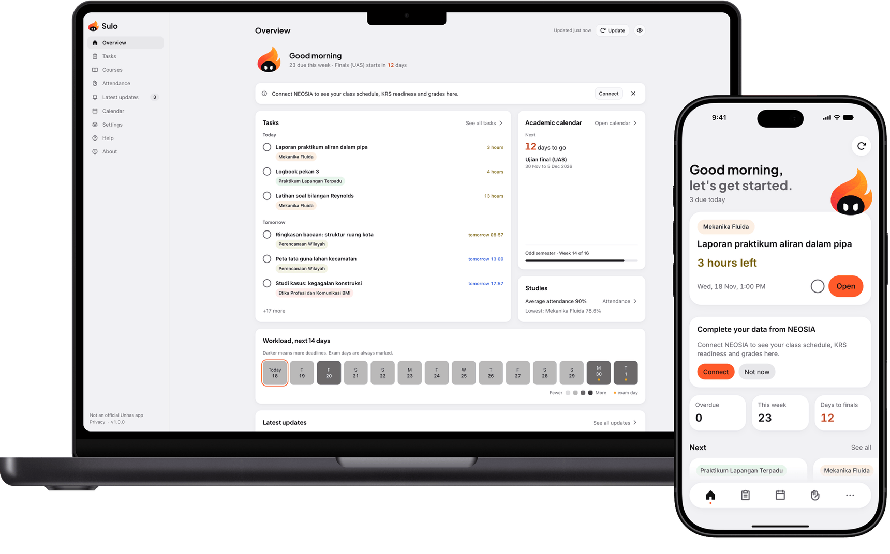

<p align="center">
  <picture>
    <source media="(prefers-color-scheme: dark)" srcset="apps/extension/assets/brand/lockup-dark.svg">
    <source media="(prefers-color-scheme: light)" srcset="apps/extension/assets/brand/lockup-light.svg">
    
  </picture>
</p>

<p align="center">
  <a href="https://github.com/Ikrar06/sulo/actions/workflows/ci.yml"></a>
  <a href="LICENSE"></a>
</p>

<p align="center"><a href="README.md">English</a></p>

Sulo mengumpulkan tugas, tenggat, dan presensi dari SIKOLA serta kalender akademik Unhas di satu tempat, lalu mengingatkanmu sebelum tenggatnya lewat. Bentuknya ekstensi browser (Chrome dan Edge) dan aplikasi Android.

**Bukan aplikasi resmi Unhas.** Sulo proyek mandiri, tidak berafiliasi dengan dan tidak didukung oleh Universitas Hasanuddin. "Sulo" berarti obor dalam bahasa Bugis dan Makassar.

<!--
Tangkapan layar ditaruh di sini setelah mockup diekspor:

<p align="center">
  <picture>
    <source media="(prefers-color-scheme: dark)" srcset="docs-publik/hero-dark.png">
    <source media="(prefers-color-scheme: light)" srcset="docs-publik/hero-light.png">
    
  </picture>
</p>
-->

## Daftar isi

- [Yang dilakukan Sulo](#yang-dilakukan-sulo)
- [Cara kerjanya](#cara-kerjanya)
- [Privasi](#privasi)
- [Cara pasang](#cara-pasang)
- [Yang sering ditanyakan](#yang-sering-ditanyakan)
- [Untuk pengembang](#untuk-pengembang)
- [Melapor masalah](#melapor-masalah)
- [Lisensi](#lisensi)

## Yang dilakukan Sulo

- **Tugas dari semua mata kuliah dalam satu daftar**, dikelompokkan: terlambat, hari ini dan besok, minggu ini, nanti. Tugas bisa ditandai selesai, dipecah jadi langkah, diberi catatan atau tenggat pribadi.
- **Pengingat** sebelum tenggat. Kamu yang memilih kapan: 3 hari, 1 hari, 6 jam, 3 jam, atau 1 jam sebelumnya. Jam tenang menyala sejak awal (22.00 sampai 06.00, bisa kamu ubah), dan ada ringkasan pagi kalau kamu mau.
- **Kabar terbaru**: tugas dan materi baru, tenggat yang berubah, nilai atau feedback baru, kabar forum.
- **Presensi** seperti yang tercatat di SIKOLA, per mata kuliah dan per sesi.
- **Kalender akademik Unhas** berdampingan dengan tenggatmu. Kalender publiknya bisa ditambahkan ke Google Kalender (dan dari ekstensi juga ke Outlook atau Apple Calendar).
- **Hanya mata kuliah yang kamu pantau**, masing-masing dengan nama tampilan dan warna pilihanmu.
- **Opsional: NEOSIA.** Jadwal kuliah, status KRS, dan nilai, dibaca dari halaman NEOSIA yang kamu buka sendiri. Mati sampai kamu menyalakannya. Nilai tersembunyi sampai kamu memilih menampilkannya.
- **Di Android:** hal yang sama di HP-mu, ditambah pilihan kunci aplikasi dan pilihan mengecek tugas baru di latar belakang.
- Tema terang dan gelap, bahasa Indonesia dan Inggris.

## Cara kerjanya

Sulo membaca apa yang bisa kamu baca sendiri di SIKOLA, lalu menyusunnya supaya tidak ada yang terlewat.

- **Di browser**, Sulo memakai login SIKOLA yang sudah ada di browsermu (sesi). Masuk ke SIKOLA seperti biasa, dan Sulo langsung mengenalinya. Tidak ada akun Sulo.
- **Di Android**, kamu masuk di halaman SIKOLA sendiri di dalam aplikasi. Yang disimpan Sulo sesinya, bukan password-nya.
- **Semuanya disimpan di perangkatmu.** Tidak ada server Sulo yang menampungnya.
- **Sulo hanya membaca.** Sulo tidak bisa mengumpulkan tugas, mengisi presensi, atau mengubah apa pun di SIKOLA maupun NEOSIA.

Saat SIKOLA mengeluarkanmu, Sulo tetap menampilkan data terakhir dan memintamu masuk lagi. Sulo tidak pernah masuk atas namamu.

## Privasi

- **Tanpa password.** Sulo tidak pernah meminta, membaca, atau menyimpan username dan password-mu.
- **Hanya membaca.** Tidak mengumpulkan tugas, tidak menandai sudah dibaca, tidak mengisi presensi, tidak mengisi KRS. Sulo tidak mengirim permintaan apa pun ke NEOSIA: Sulo hanya mencatat apa yang dimuat halaman NEOSIA sendiri saat kamu membukanya.
- **Datamu tetap di perangkatmu.** Tanpa server Sulo, tanpa analitik, tanpa iklan. Di Android, sesi SIKOLA dienkripsi dengan kunci di Android Keystore dan tidak ikut cadangan perangkat.
- **Hanya dua tujuan.** Sulo terhubung ke SIKOLA, dan ke repo data publiknya sendiri untuk satu berkas pengaturan kecil serta kalender akademik. Permintaan itu tidak membawa apa pun tentangmu. Tautan lain (Google Kalender, PDF kalender resmi, formulir masukan) baru terbuka di browser saat kamu mengekliknya.
- **Hal sensitif tersembunyi sejak awal.** Nilai dan IPK tidak pernah muncul di notifikasi, ekspor, maupun daftar yang disalin.

Kebijakan lengkap ekstensi ada di [PRIVACY.md](PRIVACY.md) (Inggris). Halaman publiknya mencakup ekstensi dan aplikasi Android, dalam bahasa [Indonesia](https://ikrar06.github.io/sulo-data/privasi.html) dan [Inggris](https://ikrar06.github.io/sulo-data/privacy.html).

## Cara pasang

Sulo masih dalam uji coba terbatas. Belum ada di Chrome Web Store maupun Edge Add-ons, dan belum ada rilis Android untuk umum. Sampai saat itu, Sulo bisa dibangun dari repo ini. Kalau kamu tidak terbiasa membangun aplikasi sendiri, tunggu rilis pertamanya; halaman ini akan memberi tahu saat sudah ada.

**Ekstensi, dari kode sumber**

1. Pasang [Node.js](https://nodejs.org) 24 dan [pnpm](https://pnpm.io) 10.
2. Di folder ini, jalankan `pnpm install --frozen-lockfile`, lalu `pnpm build`.
3. Buka `chrome://extensions` (atau `edge://extensions`) dan nyalakan Developer mode.
4. Pilih "Load unpacked", lalu pilih folder `.output/chrome-mv3`.
5. Sulo membuka panduan singkat. Masuk ke SIKOLA saat diminta, lalu pilih mata kuliah yang mau dipantau.

**Android**

Butuh Android 8.0 atau lebih baru dengan Android System WebView yang diperbarui (versi 111 atau lebih baru). Rilis akan terbit sebagai APK di GitHub Releases repo ini, tidak lewat tempat lain. Sebelum memasang, pastikan berkasnya memang yang dibangun di sini. Langkah 1 cukup untuk kebanyakan orang; langkah 2 untuk yang punya Android SDK.

1. Cocokkan SHA-256 berkas dengan berkas `.sha256` di sebelahnya di halaman rilis: `shasum -a 256 sulo-<versi>-android.apk` (Windows: `certutil -hashfile sulo-<versi>-android.apk SHA256`).
2. Periksa sertifikat tanda tangannya dengan `apksigner verify --print-certs sulo-<versi>-android.apk` (apksigner ada di build-tools Android SDK). Baris "certificate SHA-256 digest" harus berbunyi

   `43bfdbc74dc182c755977427fae9c495c55cca005cae87055df2bb651d87827f`

   Alat lain menampilkan nilai yang sama sebagai `43:BF:DB:C7:4D:C1:82:C7:55:97:74:27:FA:E9:C4:95:C5:5C:CA:00:5C:AE:87:05:5D:F2:BB:65:1D:87:82:7F`.

APK dengan sidik jari lain bukan dari proyek ini.

## Yang sering ditanyakan

**Ini dari kampus?** Bukan. Sulo dibuat oleh satu mahasiswa Unhas di waktu luangnya. Tenggat, nilai, dan aturan yang berlaku tetap yang ada di SIKOLA, NEOSIA, dan dari dosen PA-mu.

**Bisakah Sulo mengumpulkan tugas, mengisi presensi, atau mengisi KRS untukku?** Tidak, dan tidak akan pernah. Sulo hanya membaca.

**Apakah Sulo melihat password-ku?** Tidak. Kamu masuk di halaman SIKOLA sendiri. Sulo hanya memakai sesi yang dihasilkan dari situ.

**Kenapa aku diminta masuk lagi ke SIKOLA?** SIKOLA mengakhiri sesi setelah beberapa jam. Ekstensi browser tidak melakukan apa pun untuk menjaga sesi itu tetap hidup. Di Android, pembaruan yang kamu mulai sendiri dihitung sebagai aktivitas, sama seperti membuka SIKOLA; di latar belakang, sesi hanya dijaga kalau kamu menyalakan "Pantau tugas baru".

**Apakah Sulo membebani SIKOLA?** Sulo meminta satu hal dalam satu waktu, tidak pernah berbarengan, tetap di bawah batas harian, dan menahan diri saat SIKOLA lambat atau menolak. Pengelola bisa menjeda semua pemasangan dari jauh.

**Bagaimana cara menghapus dataku?** Di ekstensi: Pengaturan, "Hapus data", lalu "Hapus semua data". Di Android: Lainnya, Pengaturan, "Keluar dan hapus data". Data di SIKOLA tidak tersentuh.

**Kalau yang ditampilkan Sulo keliru?** Isinya bisa ketinggalan atau tidak lengkap. Cek SIKOLA, lalu [kabari kami](#melapor-masalah).

## Untuk pengembang

### Kebutuhan dan persiapan

Node.js 24 atau lebih baru dan pnpm 10 (versi pnpm persisnya dikunci di `package.json`). Build Android juga butuh JDK 21 dan Android SDK; `pnpm mobile:doctor` menyebut apa yang kurang.

```sh
pnpm install --frozen-lockfile
git config core.hooksPath .githooks   # memindai tiap commit dari data pribadi atau data sesi
```

| Perintah | Kegunaan |
| --- | --- |
| `pnpm dev` | Ekstensi dengan hot reload |
| `pnpm build` | Build produksi ekstensi di `.output/chrome-mv3` |
| `pnpm test` | Test unit ekstensi, logika bersama yang dipakainya, dan aplikasi Android (Vitest) |
| `pnpm typecheck` | TypeScript, mode strict, untuk semua paket |
| `pnpm lint` | Aturan UI, aturan core tanpa platform, dan pemindai data pribadi |
| `pnpm mobile:web` | Antarmuka aplikasi Android di browser desktop, dengan akun demo sintetis |
| `pnpm mobile:apk:debug` | APK debug |
| `pnpm shots:audit --out <folder>` | Tangkapan semua layar dan keadaan, dari data sintetis |

`pnpm mobile:web` cara tercepat untuk melihat-lihat: tidak butuh akun SIKOLA dan tidak mengirim permintaan apa pun ke SIKOLA. Untuk ekstensi, `pnpm dev` menambah halaman pratinjau (`preview.html`) yang menampilkan popup dan panduan pertama dari data sintetis serupa.

Test ada di `apps/extension/tests/` (sekaligus menguji `packages/core`) dan `apps/mobile/tests/`. Satu berkas: `pnpm --filter @sulo/extension exec vitest run tests/backoff.test.ts`.

### Susunan repo

```
packages/core/     logika bersama, tanpa API browser atau DOM: klien SIKOLA, pembaruan, tugas,
                   pengingat, kalender, presensi, pembacaan NEOSIA, dan semua teks (i18n)
packages/ui/       komponen React bersama, ikon, dan maskot
apps/extension/    ekstensi browser (WXT, Manifest V3): popup, dashboard, onboarding
apps/mobile/       aplikasi Android (Capacitor) dan mode web-nya untuk pengembangan
apps/mobile/android/  Kotlin native: layar login SIKOLA, penyimpanan sesi terenkripsi,
                   worker pemantauan latar belakang
```

Teknologi: TypeScript, React, Tailwind CSS, Zod, dan Vitest, dengan WXT untuk ekstensi dan Capacitor untuk Android.

### Aturan yang dipegang kodenya

- **Satu pintu ke SIKOLA.** Semua permintaan dari ekstensi, dan semua permintaan aplikasi Android selama dibuka, lewat `packages/core/src/moodle/client.ts`: daftar fungsi Moodle baca-saja yang diizinkan, antrean satu per satu (tidak pernah dua permintaan sekaligus), anggaran harian, dan jeda 3, 6, 12, lalu 24 jam setelah gagal. Angkanya ada di `packages/core/src/moodle/limits.ts`. Pengecekan latar belakang Android dikerjakan worker native kecil (`WatchWorker.kt`) yang hanya mengikuti rencana tulisan logika bersama (`packages/core/src/watch/plan.ts`): panggilan, anggaran, dan jeda yang sama.
- **Tidak ada yang dipercaya tanpa dicek.** Setiap respons SIKOLA divalidasi dengan Zod. Respons yang tidak cocok dilaporkan ke pengguna sebagai masalah membaca, tidak pernah ditampilkan sebagai daftar kosong.
- **Tenang di latar belakang.** Ekstensi memperbarui kira-kira tiap 3 jam selama kamu memakai komputer, sekali lagi saat kamu kembali kalau datanya sudah lebih dari sejam, tidak pernah antara pukul 00.00 dan 06.00, dan tidak memperpanjang sesi SIKOLA. Aplikasi Android mengecek di latar belakang hanya kalau pengguna menyalakan "Pantau tugas baru": bawaannya kira-kira tiap 20 menit di siang hari dan tiap 110 menit di malam hari.
- **Nol permintaan ke NEOSIA.** Modul opsional itu hanya membaca respons yang diminta halaman NEOSIA sendiri, hanya mengambil kolom yang ada di daftar yang diizinkan, dan membuang sisanya sebelum ada yang disimpan.
- **Tidak ada data asli di repo.** Fixture di `apps/extension/fixtures/synthetic/` ditulis tangan, dan `pnpm check-leaks` berjalan sebelum tiap commit dan paling awal di CI.
- **Tombol henti jarak jauh.** Satu berkas pengaturan publik bisa menjeda pembaruan di semua pemasangan. Isinya hanya data, divalidasi, dan tidak pernah bisa membawa kode.

### Izin

| Tempat | Izin | Untuk apa |
| --- | --- | --- |
| Ekstensi | `storage`, `alarms`, `notifications`, `idle` | menyimpan data di perangkat, menjadwalkan pembaruan dan pengingat, menampilkannya, dan diam saat kamu tidak di depan komputer |
| Ekstensi | host `https://sikola-v2.unhas.ac.id/*` | membaca SIKOLA dengan sesimu |
| Ekstensi, opsional | `scripting` dan host NEOSIA (`https://neosia.unhas.ac.id/*`) | hanya saat kamu menyalakan modul NEOSIA; dicabut saat dimatikan |
| Android | internet dan status jaringan | membaca SIKOLA dan repo data publik |
| Android | notifikasi, mulai ulang, dan wake lock | pengingat dan pengecekan latar belakang, dijadwalkan lagi setelah HP dinyalakan ulang |
| Android | biometrik | kunci aplikasi (opsional) |

Daftar izin Android ditegakkan di tiap build rilis oleh `apps/mobile/scripts/check-permissions.mjs`.

### Test dan CI

CI (`.github/workflows/ci.yml`) menjalankan pemindai data pribadi, lint, typecheck, test unit, build produksi ekstensi, dan build debug aplikasi Android. Pemeriksaan tata letak yang butuh browser (`pnpm --filter @sulo/extension check:fit`, `pnpm --filter @sulo/mobile check:fit`, dan `check:onboarding-layout` dengan cara yang sama) dan skrip tangkapan layar dijalankan lokal. Test dan tangkapan layar hanya memakai data sintetis: jangan pernah menaruh data mahasiswa asli di fixture, tangkapan layar, issue, atau commit.

## Melapor masalah

Buka issue lewat formulir laporan bug. Jangan sertakan cookie, token, NIM, atau tangkapan layar yang memuat data pribadi. Untuk celah keamanan, ikuti [SECURITY.md](SECURITY.md), jangan lewat issue.

Mau ikut menyumbang? Baca [CONTRIBUTING.md](CONTRIBUTING.md) dulu; perubahan besar dimulai dari issue. Semua yang terlibat mengikuti [Code of Conduct](CODE_OF_CONDUCT.md). Daftar perubahan ada di [CHANGELOG.md](CHANGELOG.md).

## Lisensi

Kodenya berlisensi [MIT](LICENSE).

- Font yang dibundel, Inter dan Plus Jakarta Sans, berlisensi SIL Open Font License 1.1 (`apps/extension/assets/fonts/*/OFL.txt`).
- Ikon antarmuka berasal dari [Phosphor Icons](https://phosphoricons.com) (lisensi MIT); lihat [NOTICE](NOTICE).
- Nama, logo, dan maskot Sulo tidak termasuk lisensi MIT; lihat [TRADEMARK.md](TRADEMARK.md).

Isi Sulo bisa tidak lengkap atau ketinggalan. Untuk hal penting seperti tenggat, nilai, dan aturan akademik, yang berlaku adalah sistem resmi kampus dan dosen PA-mu.
