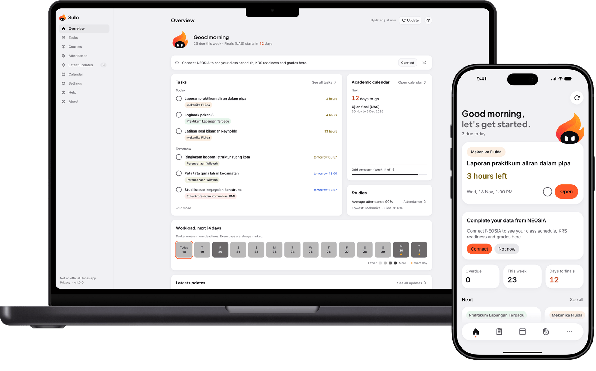

<p align="center">
  <picture>
    <source media="(prefers-color-scheme: dark)" srcset="apps/extension/assets/brand/lockup-dark.svg">
    <source media="(prefers-color-scheme: light)" srcset="apps/extension/assets/brand/lockup-light.svg">
    
  </picture>
</p>

<p align="center">
  <a href="https://github.com/Ikrar06/sulo/actions/workflows/ci.yml"></a>
  <a href="LICENSE"></a>
</p>

<p align="center"><a href="README.id.md">Bahasa Indonesia</a></p>

Sulo puts your SIKOLA tasks, deadlines and attendance and the Unhas academic calendar in one place, and reminds you before things are due. It is a browser extension (Chrome and Edge) and an Android app.

**Not an official Unhas app.** Sulo is an independent project, not affiliated with or endorsed by Universitas Hasanuddin. The name means "torch" in Buginese and Makassarese.

<p align="center">
  <picture>
    <source type="image/webp" media="(prefers-color-scheme: dark)" srcset="docs-publik/hero-dark.webp">
    <source type="image/webp" media="(prefers-color-scheme: light)" srcset="docs-publik/hero-light.webp">
    <source media="(prefers-color-scheme: dark)" srcset="docs-publik/hero-dark.png">
    
  </picture>
</p>

<p align="center"><sub>The extension's dashboard and the Android app, with sample data. The phone frame is only for the picture: Sulo's phone app is for Android.</sub></p>

## Contents

- [What it does](#what-it-does)
- [How it works](#how-it-works)
- [Privacy](#privacy)
- [Install](#install)
- [Questions people ask](#questions-people-ask)
- [For developers](#for-developers)
- [Reporting a problem](#reporting-a-problem)
- [License](#license)

## What it does

- **Tasks from every course in one list**, grouped as overdue, today and tomorrow, this week and later. Mark a task as done, split it into steps, add a note or a due date of your own.
- **Reminders** before a due date. You pick when: 3 days, 1 day, 6 hours, 3 hours or 1 hour before. Quiet hours are on from the start (22:00 to 06:00, yours to change), and a morning summary is there if you want it.
- **Latest updates**: new tasks and materials, changed due dates, new grades or feedback, forum posts.
- **Attendance** as SIKOLA records it, per course and per session.
- **The Unhas academic calendar** next to your own deadlines. Its public calendars can be added to Google Calendar (and, from the extension, to Outlook or Apple Calendar).
- **Only the courses you follow**, each with a display name and color you choose.
- **Optional: NEOSIA.** Your class schedule, KRS status and grades, read from the NEOSIA pages you open yourself. Off until you turn it on. Grades stay hidden until you choose to show them.
- **On Android:** the same on your phone, plus an optional app lock and an optional background check for new tasks.
- Light and dark themes, Indonesian and English.

## How it works

Sulo reads what you could read yourself in SIKOLA and lays it out so nothing gets missed.

- **In the browser** it uses the sign-in your browser already has with SIKOLA (the session). Sign in to SIKOLA as usual, and Sulo picks it up. There is no Sulo account.
- **On Android** you sign in on SIKOLA's own page inside the app. Sulo keeps the session, never the password.
- **Everything is kept on your device.** There is no Sulo server for it to go to.
- **It only reads.** Sulo cannot hand in work, fill in attendance or change anything in SIKOLA or NEOSIA.

When SIKOLA signs you out, Sulo keeps showing the last data it has and asks you to sign in again. It never does that for you.

## Privacy

- **No password.** Sulo never asks for, reads or stores your username or password.
- **Read only.** No submitting, no marking as read, no attendance, no KRS. Sulo sends no request to NEOSIA at all: it only notes what NEOSIA's own page loads while you have it open.
- **Your data stays on your device.** No Sulo server, no analytics, no ads. On Android the SIKOLA session is encrypted with a key held in the Android Keystore and is left out of device backups.
- **Two places only.** Sulo talks to SIKOLA, and to its own public data repository for a small settings file and the academic calendar. Those requests carry nothing about you. Every other link (Google Calendar, the official calendar PDF, the feedback form) opens in your browser only when you click it.
- **Sensitive things are hidden by default.** Grades and GPA never appear in notifications, exports or copied lists.

The extension's full policy is in [PRIVACY.md](PRIVACY.md). The public page covers the extension and the Android app, in [English](https://ikrar06.github.io/sulo-data/privacy.html) and [Indonesian](https://ikrar06.github.io/sulo-data/privasi.html).

## Install

Sulo is in a limited trial. It is not in the Chrome Web Store or Edge Add-ons yet, and there is no public Android release yet. Until then it can be built from this repository. If you do not build software yourself, wait for the first release; this page will say so when it is out.

**Extension, from source**

1. Install [Node.js](https://nodejs.org) 24 and [pnpm](https://pnpm.io) 10.
2. In this folder, run `pnpm install --frozen-lockfile`, then `pnpm build`.
3. Open `chrome://extensions` (or `edge://extensions`) and turn on Developer mode.
4. Choose "Load unpacked" and select the folder `.output/chrome-mv3`.
5. Sulo opens a short guide. Sign in to SIKOLA when it asks, then pick the courses to follow.

**Android**

Needs Android 8.0 or newer with an up-to-date Android System WebView (version 111 or newer). Releases will be published as an APK on this repository's GitHub Releases and nowhere else. Before installing one, check that it is the file built here. Step 1 is enough for most people; step 2 is for those who have the Android SDK.

1. Compare the file's SHA-256 with the `.sha256` file next to it on the release page: `shasum -a 256 sulo-<version>-android.apk` (Windows: `certutil -hashfile sulo-<version>-android.apk SHA256`).
2. Check the signing certificate with `apksigner verify --print-certs sulo-<version>-android.apk` (apksigner comes with the Android SDK build-tools). The line "certificate SHA-256 digest" must read

   `43bfdbc74dc182c755977427fae9c495c55cca005cae87055df2bb651d87827f`

   Other tools show the same value as `43:BF:DB:C7:4D:C1:82:C7:55:97:74:27:FA:E9:C4:95:C5:5C:CA:00:5C:AE:87:05:5D:F2:BB:65:1D:87:82:7F`.

An APK with another fingerprint is not from this project.

## Questions people ask

**Is this from the university?** No. Sulo is made by one Unhas student, on their own time. Deadlines, grades and rules in SIKOLA, NEOSIA and from your academic advisor are the ones that count.

**Can Sulo hand in a task, or fill in attendance or KRS for me?** No, and it never will. Sulo only reads.

**Does Sulo see my password?** No. You sign in on SIKOLA's own page. Sulo only uses the session that sign-in creates.

**Why does it ask me to sign in to SIKOLA again?** SIKOLA ends a session after some hours. The browser extension does nothing to keep it alive. On Android, an update you start yourself counts as activity, the same as opening SIKOLA; nothing keeps the session going in the background unless you turn on "Watch for new tasks".

**Does it put load on SIKOLA?** Sulo asks one thing at a time, never in parallel, stays under a daily limit, and backs off when SIKOLA is slow or refuses. The maintainer can pause every installation remotely.

**How do I delete my data?** In the extension: Settings, "Delete data", then "Delete all data". On Android: More, Settings, "Sign out and delete data". Nothing in SIKOLA is touched.

**What if Sulo shows something wrong?** It can be out of date or incomplete. Check SIKOLA, then [tell us](#reporting-a-problem).

## For developers

### Requirements and setup

Node.js 24 or newer and pnpm 10 (the exact pnpm version is pinned in `package.json`). The Android build also needs JDK 21 and the Android SDK; `pnpm mobile:doctor` says what is missing.

```sh
pnpm install --frozen-lockfile
git config core.hooksPath .githooks   # scans every commit for personal or session data
```

| Command | What it does |
| --- | --- |
| `pnpm dev` | The extension with hot reload |
| `pnpm build` | Production build of the extension in `.output/chrome-mv3` |
| `pnpm test` | Unit tests of the extension, the shared logic it uses, and the Android app (Vitest) |
| `pnpm typecheck` | TypeScript, strict, for every package |
| `pnpm lint` | UI rules, the core's no-platform rule and the personal-data scan |
| `pnpm mobile:web` | The Android app's interface in a desktop browser, with a synthetic demo account |
| `pnpm mobile:apk:debug` | A debug APK |
| `pnpm shots:audit --out <dir>` | Screenshots of every screen and state, from synthetic data |

`pnpm mobile:web` is the quickest way to look around: it needs no SIKOLA account and makes no request to SIKOLA. For the extension, `pnpm dev` adds a preview page (`preview.html`) that shows the popup and the first-run guide from the same kind of synthetic data.

Tests live in `apps/extension/tests/` (they also cover `packages/core`) and `apps/mobile/tests/`. One file: `pnpm --filter @sulo/extension exec vitest run tests/backoff.test.ts`.

### Repository layout

```
packages/core/     shared logic, no browser or DOM APIs: the SIKOLA client, sync, tasks,
                   reminders, calendar, attendance, NEOSIA parsing, and every text (i18n)
packages/ui/       shared React components, icons and the mascot
apps/extension/    the browser extension (WXT, Manifest V3): popup, dashboard, onboarding
apps/mobile/       the Android app (Capacitor) and its web mode for development
apps/mobile/android/  native Kotlin: SIKOLA's login screen, the encrypted session store,
                   the background watch worker
```

Stack: TypeScript, React, Tailwind CSS, Zod and Vitest, with WXT for the extension and Capacitor for Android.

### Rules the code holds itself to

- **One door to SIKOLA.** Every request the extension makes, and every request the Android app makes while it is open, goes through `packages/core/src/moodle/client.ts`: an allowlist of read-only Moodle functions, a serial queue (never two requests at once), a daily budget, and a backoff of 3, 6, 12 and then 24 hours after failures. The numbers are in `packages/core/src/moodle/limits.ts`. The Android background check is a small native worker (`WatchWorker.kt`) that only follows a plan the shared logic writes (`packages/core/src/watch/plan.ts`): the same calls, the same budget and backoff.
- **Nothing trusted unchecked.** Every SIKOLA response is validated with Zod. A response that does not fit is reported to the user as a reading problem, never shown as an empty list.
- **Quiet in the background.** The extension updates about every 3 hours while you are using the computer, once more when you come back to it if the data is over an hour old, never between 00:00 and 06:00, and it does not extend the SIKOLA session. The Android app checks in the background only when the user turns on "Watch for new tasks": by default about every 20 minutes by day and every 110 minutes at night.
- **Zero requests to NEOSIA.** The optional module reads only the responses NEOSIA's own page asks for, keeps an allowlisted set of fields and drops the rest before anything is stored.
- **No real data in the repository.** Fixtures in `apps/extension/fixtures/synthetic/` are written by hand, and `pnpm check-leaks` runs before every commit and first in CI.
- **A remote off switch.** A public settings file can pause updates for every installation. It is data only, validated, and can never carry code.

### Permissions

| Where | Permission | Why |
| --- | --- | --- |
| Extension | `storage`, `alarms`, `notifications`, `idle` | keep data locally, schedule updates and reminders, show them, and stay quiet while you are away |
| Extension | host `https://sikola-v2.unhas.ac.id/*` | read SIKOLA with your session |
| Extension, optional | `scripting` and the NEOSIA host (`https://neosia.unhas.ac.id/*`) | only when you turn the NEOSIA module on; removed when you turn it off |
| Android | internet and network state | read SIKOLA and the public data repository |
| Android | notifications, restart and wake lock | reminders and background checks, rescheduled after a restart |
| Android | biometric | the optional app lock |

The Android list is enforced on every release build by `apps/mobile/scripts/check-permissions.mjs`.

### Tests and CI

CI (`.github/workflows/ci.yml`) runs the personal-data scan, lint, typecheck, the unit tests, the production build of the extension and a debug build of the Android app. Layout checks that need a browser (`pnpm --filter @sulo/extension check:fit`, `pnpm --filter @sulo/mobile check:fit`, and `check:onboarding-layout` the same way) and the screenshot scripts run locally. Tests and screenshots use synthetic data only: never put real student data in a fixture, a screenshot, an issue or a commit.

## Reporting a problem

Open an issue with the bug report form. Leave out cookies, tokens, student numbers and screenshots that show personal data. For a security problem, follow [SECURITY.md](SECURITY.md) instead of opening an issue.

Thinking of contributing? Read [CONTRIBUTING.md](CONTRIBUTING.md) first; larger changes start as an issue. Everyone taking part follows the [Code of Conduct](CODE_OF_CONDUCT.md). Changes are listed in [CHANGELOG.md](CHANGELOG.md).

## License

The code is under the [MIT License](LICENSE).

- The bundled fonts, Inter and Plus Jakarta Sans, are under the SIL Open Font License 1.1 (`apps/extension/assets/fonts/*/OFL.txt`).
- The interface icons are from [Phosphor Icons](https://phosphoricons.com) (MIT License); see [NOTICE](NOTICE).
- The Sulo name, logo and mascot are not covered by the MIT License; see [TRADEMARK.md](TRADEMARK.md).

Sulo can be incomplete or out of date. For anything that matters, such as deadlines, grades or academic rules, the university's own systems and your academic advisor are authoritative.
